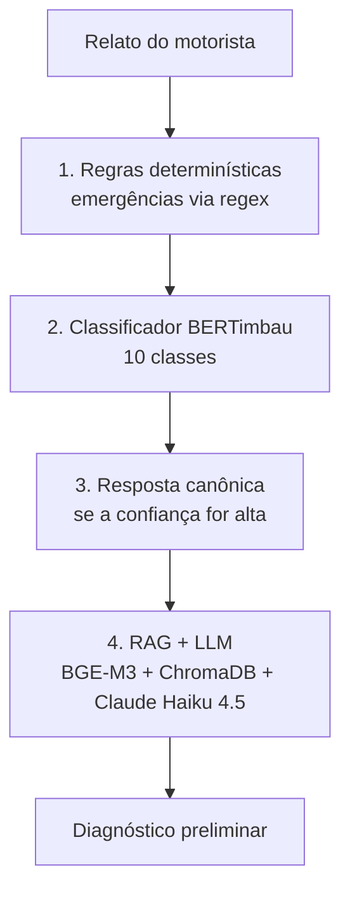

# Mão na Roda: Diagnóstico Preliminar de Falhas Automotivas com IA


Sistema que recebe, em português, o relato de um motorista leigo sobre uma falha do carro, classifica o sintoma em 1 de 10 sistemas do veículo e gera um diagnóstico **preliminar** com um LLM apoiado em manuais técnicos.

> ⚠️ **Projeto acadêmico.** Os resultados são preliminares e não substituem a avaliação de um mecânico.

**Instituição:** Universidade Presbiteriana Mackenzie, 2026
**Equipe:** Diego Spagnuolo Sugai, Kauê Henrique Matias Alves, Leonardo Moreira dos Santos, Victor Maki Tarcha
**Orientador:** Prof. Dr. Ivan Carlos Alcântara de Oliveira

<!-- Depois de subir o print da demo em docs/img/demo.png, apague esta linha e a de fechamento e deixe só a imagem:

-->

## O problema

Motoristas descrevem falhas de forma informal, coloquial ou regional (*"o freio tá esponjoso"*, *"tin tin no canto da roda"*), bem longe da linguagem de manuais técnicos e de sistemas de diagnóstico. O projeto combina classificação supervisionada com geração aumentada por recuperação (RAG) para responder a esse tipo de relato.

## Pipeline de pesquisa



A **demo** em [`demo/`](demo/) é um protótipo simplificado: só o classificador e o Claude estão ativos. Regras, base canônica e RAG estão desativados. Detalhes em [`demo/README.md`](demo/README.md).

### Classes

| ID | Classe | ID | Classe |
|---|---|---|---|
| 0 | Bateria / Sistema Elétrico | 5 | Vazamento de Óleo |
| 1 | Sistema de Freios | 6 | Sistema de Arrefecimento |
| 2 | Superaquecimento do Motor | 7 | Pneu / Roda |
| 3 | Suspensão / Amortecedores | 8 | Injeção / Combustível |
| 4 | Transmissão / Câmbio | 9 | Sistema de Escapamento |

## Resultados oficiais

### Classificador (F1 macro no teste, dataset v15)

| Modelo | F1 macro | Acurácia |
|---|---|---|
| DeBERTinha | **0,878** | n/d |
| BERTimbau | 0,8675 | 0,8684 |
| BERTabaporu | 0,8617 | n/d |
| JabuticaBERT | 0,839 | n/d |

- Treino do BERTimbau: `WeightedTrainer` (perda ponderada por classe), early stopping, melhor época 6 de 15.
- A hipótese de que o BERTabaporu, pré-treinado em tweets, seria melhor em texto coloquial **não se confirmou**: o F1 ficou abaixo do BERTimbau, com ganhos apenas seletivos.
- A principal confusão é entre **Superaquecimento do Motor** e **Sistema de Arrefecimento**.
- O F1 mede só o classificador. O pipeline completo foi avaliado de forma qualitativa (abaixo).

#### BERTimbau por classe (teste, 304 relatos)

| Classe | Precisão | Recall | F1 | Suporte |
|---|---|---|---|---|
| Bateria / Sistema Elétrico | 0,923 | 0,774 | 0,842 | 31 |
| Sistema de Freios | 0,935 | 0,935 | 0,935 | 31 |
| Superaquecimento do Motor | 0,679 | 0,633 | 0,655 | 30 |
| Suspensão / Amortecedores | 0,900 | 0,871 | 0,885 | 31 |
| Transmissão / Câmbio | 0,906 | 0,935 | 0,921 | 31 |
| Vazamento de Óleo | 0,903 | 0,933 | 0,918 | 30 |
| Sistema de Arrefecimento | 0,743 | 0,867 | 0,800 | 30 |
| Pneu / Roda | 0,933 | 0,933 | 0,933 | 30 |
| Injeção / Combustível | 0,897 | 0,867 | 0,881 | 30 |
| Sistema de Escapamento | 0,875 | 0,933 | 0,903 | 30 |
| **Média macro** | 0,869 | 0,868 | **0,8675** | 304 |

Acurácia: 0,8684. Das confusões, 9 relatos de Superaquecimento foram previstos como Arrefecimento e 3 no sentido inverso. Superaquecimento é a classe mais difícil (F1 0,655).

<!-- TODO: F1 do baseline nos splits da v15 (o notebook de baseline do repositório roda no dataset piloto) -->

Detalhes dos modelos e links: [`models/README.md`](models/README.md).

### Ablação do pipeline (nota média Likert)

| Configuração | Nota |
|---|---|
| A | 1,67 |
| **B (sem regras)** | **2,78** |
| C | 1,67 |
| D | 2,56 |

A configuração B, sem regras heurísticas, foi a melhor avaliada. A ablação foi executada sobre **17 relatos de teste da fase piloto**, com o classificador daquela fase; ela compara o efeito de regras e RAG+LLM, não o desempenho do classificador final.

<!-- TODO: descrever em uma linha as configs A, C e D e a escala Likert -->

## Dados

- **Dataset v15:** 3.041 registros em 10 classes (2.432 treino, 305 validação e 304 teste), em [`data/`](data/). Os splits são por grupo de paráfrase, sem sobreposição entre treino, validação e teste. O dataset contém famílias de paráfrases e a coluna `peso_treino`, então não são 3.041 relatos independentes de motoristas.
- **Corpus do RAG:** manuais do proprietário da Chevrolet (2011–2016), em [`data/manuais/`](data/manuais/). São material de terceiros, incluídos apenas para fins acadêmicos.

## Estrutura do repositório

```
├── data/        dataset v15, splits e manuais (corpus do RAG)
├── notebooks/   notebooks oficiais (EDA, baseline, treino, ingestão, pipeline, ablação, avaliação)
├── results/     relatórios, ablação e notas Likert
├── paper/       artigo
├── prompts/     prompts usados
├── demo/        protótipo web (Flask)
├── docs/        guia de instalação
└── models/      documentação dos modelos (pesos no Hugging Face)
```

## Como rodar a demo

Requer Python 3.12+ e uma chave da API da Anthropic. Passo a passo em [`docs/GUIA_RAPIDO_INSTALACAO.md`](docs/GUIA_RAPIDO_INSTALACAO.md).

## Limitações

- Só português e só 10 categorias.
- O diagnóstico e as faixas de custo vêm de um LLM e podem estar errados.
- A ablação usa um conjunto de teste pequeno (17 relatos) e o classificador da fase piloto.
- O corpus cobre apenas modelos Chevrolet.

## Contato

Abra uma *issue* neste repositório.

## Referências

- LEWIS, P. et al. **Retrieval-augmented generation for knowledge-intensive NLP tasks.** NeurIPS, 2020.
- SOUZA, F.; NOGUEIRA, R.; LOTUFO, R. **BERTimbau: pretrained BERT models for Brazilian Portuguese.** BRACIS, 2020.
- CAMPIOTTI, I. et al. **DeBERTinha: a multistep approach to adapt DebertaV3 XSmall for Brazilian Portuguese NLU.** 2023. arXiv:2309.16844.
- COSTA, P. B. et al. **BERTabaporu: assessing a genre-specific language model for Portuguese NLP.** RANLP, 2023.
- RUSSELL, S.; NORVIG, P. **Inteligência Artificial: uma abordagem moderna.** 4. ed. LTC, 2021.
