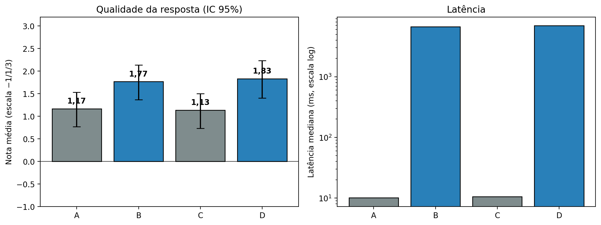

# Resultados

## `likert/`: avaliação Likert do pipeline

30 relatos do conjunto de teste (80/10/10), 3 por classe, 4 configurações (A, B, C, D) e 2 avaliadores. Escala: 3 adequada, 1 parcial, −1 inadequada. Resumo e interpretação em [`../README.md`](../README.md).

| Arquivo | Conteúdo |
|---|---|
| `likert_tabela_configuracoes.csv` | média, desvio, IC 95%, latência, % por etapa e acerto de classe por configuração |
| `likert_comparacoes_pareadas.csv` | diferenças entre configurações com IC 95% e p de Wilcoxon |
| `likert_notas_por_resposta.csv` | nota de cada avaliador (R1, R2) por resposta, com etapa, latência, tokens e custo |
| `likert_por_registro.csv` | nota média por variação linguística e configuração |
| `likert_figura.png` | figura dos resultados |
| `classificador_por_registro.csv` | acurácia e F1 do classificador por variação linguística (teste completo, 304 relatos) |
| `classificador_sinalizacao.csv` | efeito de sinalizar respostas por limiar de confiança |
| `amostra_30_relatos.csv` | os 30 relatos avaliados |
| `respostas_geradas_gabarito.csv` | respostas geradas pelo sistema para cada item |
| `gabarito_itens.csv` | mapa entre item avaliado, relato e configuração (avaliação cega) |
| `avaliacao_R1.xlsx`, `avaliacao_R2.xlsx` | planilhas preenchidas pelos dois avaliadores |
| `parametros_geracao.json` | parâmetros da geração (modelo, temperatura, `max_tokens`, top-k, limiar de confiança) |
| `matriz_confusao_final.png` | matriz de confusão do BERTimbau (split 80/10/10, teste) |

